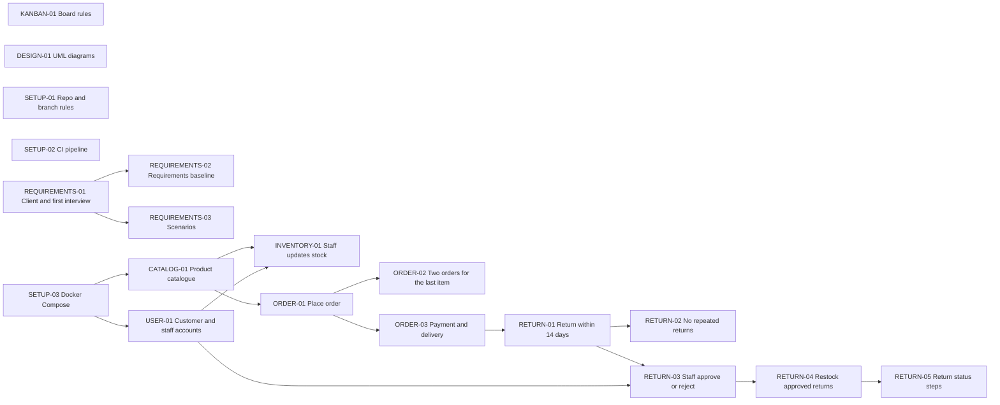

# Dependency map

An arrow means the card on the left has to be Done before the card on the right can go to Ready.

## Same thing as a table

| Card | Blocked by | Blocks |
|---|---|---|
| KANBAN-01 | nothing | nothing |
| SETUP-01 | nothing, the repo already exists | nothing |
| SETUP-02 | nothing, the repo already exists | nothing |
| SETUP-03 | nothing, the repo already exists | USER-01, CATALOG-01 |
| REQUIREMENTS-01 | nothing | REQUIREMENTS-02, REQUIREMENTS-03 |
| REQUIREMENTS-02 | REQUIREMENTS-01 | nothing |
| REQUIREMENTS-03 | REQUIREMENTS-01 | nothing |
| DESIGN-01 | nothing, a first draft can start right away | nothing |
| USER-01 | SETUP-03 | INVENTORY-01, RETURN-03 |
| CATALOG-01 | SETUP-03 | INVENTORY-01, ORDER-01 |
| INVENTORY-01 | CATALOG-01, USER-01 | nothing |
| ORDER-01 | CATALOG-01 | ORDER-02, ORDER-03 |
| ORDER-02 | ORDER-01 | nothing |
| ORDER-03 | ORDER-01 | RETURN-01 |
| RETURN-01 | ORDER-03 | RETURN-02, RETURN-03 |
| RETURN-02 | RETURN-01 | nothing |
| RETURN-03 | RETURN-01, USER-01 | RETURN-04 |
| RETURN-04 | RETURN-03 | RETURN-05 |
| RETURN-05 | RETURN-04 | nothing |

## Can start right now

KANBAN-01, SETUP-01, SETUP-02, SETUP-03, REQUIREMENTS-01, DESIGN-01

The numbers in card IDs only show the order we created them in. They don't mean the cards have to be done in that order. This map does.
